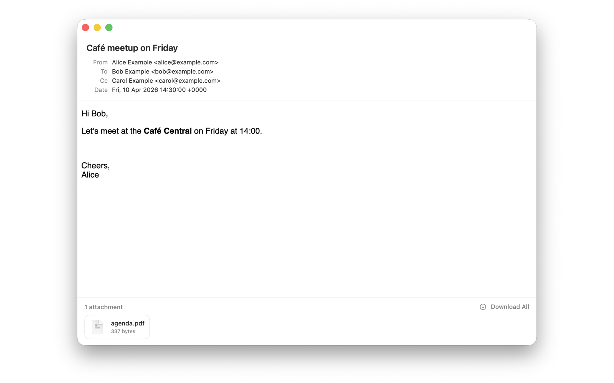

<p align="center">
  
</p>

# EMLViewer

Minimalist `.eml` and `.msg` viewer for macOS. Double-click an email in Finder - the window opens, renders the message and gets out of your way. Built with Swift, SwiftUI, AppKit and WKWebView. Zero runtime dependencies.

<p align="center">
  
</p>

## Features

- Two formats in one binary
  - `.eml` (RFC 822 / MIME): full MIME tree, RFC 2047 encoded-words, quoted-printable, base64, charset decoding
  - `.msg` (Outlook Compound File Binary): CFB parser reads subject, sender, recipients, plain and HTML body, inline images and attachments via MAPI property streams
- Decoded headers: `From`, `To`, `Cc`, `Subject`, `Date`
- HTML rendering via `WKWebView` with inline `cid:` images resolved from MIME parts
- Plain-text fallback for messages without an HTML part
- Attachments bar with Finder-style file icons, click to open in the default app, `Download All` to `~/Downloads`
- One-click `Set as default for .eml and .msg`: after that, double-clicking a message just opens the window, reads the file, shows it. No onboarding, no tray, no background daemon
- Light / Dark / System appearance, window size persisted across launches (SwiftData)
- `emlcheck` CLI companion for inspecting MIME trees from the terminal

## Install

### Homebrew

```bash
brew tap noma4i/emlviewer https://github.com/noma4i/emlviewer
brew install --cask emlviewer
```

### Download

Grab the latest `EMLViewer.app.zip` from [Releases](https://github.com/noma4i/emlviewer/releases).

## Requirements

- macOS 14.0+ (Sonoma or later, required by SwiftData)
- Swift 5.9+
- Xcode 15+ (or just the Swift CLI for SPM builds)
- [`xcodegen`](https://github.com/yonaskolb/XcodeGen) for regenerating the Xcode project (`brew install xcodegen`)

## Build

### Quick (SPM)

```bash
make bundle      # dist/EMLViewer.app (release, ad-hoc signed)
make install     # copy into /Applications
```

### Debug loop

```bash
make run                     # kill running instance, rebuild debug, open the new .app
./Scripts/build.sh release   # same but release config
```

### Xcode project (for App Store / signed archive)

```bash
xcodegen generate
open EMLViewer.xcodeproj
```

## Test

```bash
make test
```

## License

MIT
